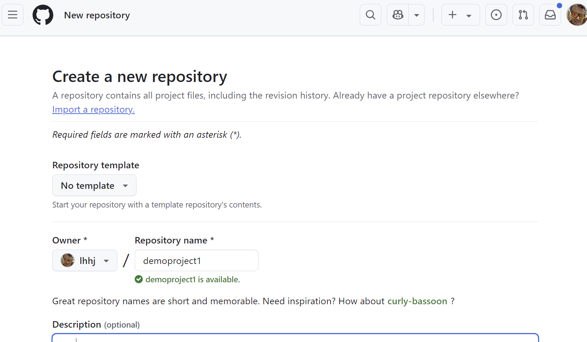
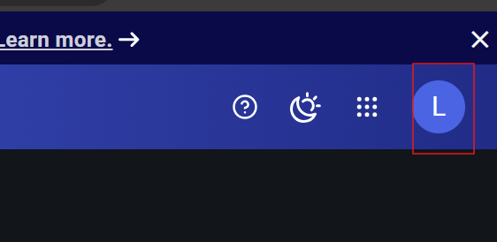
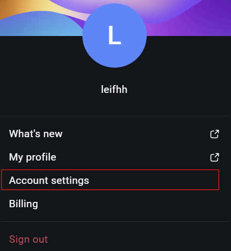
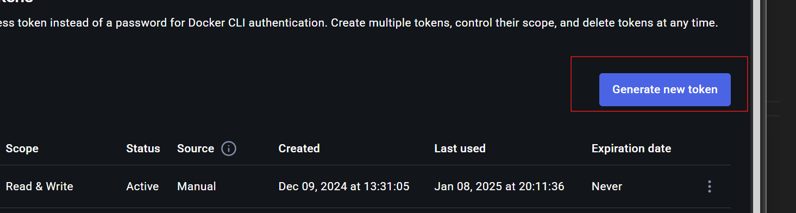
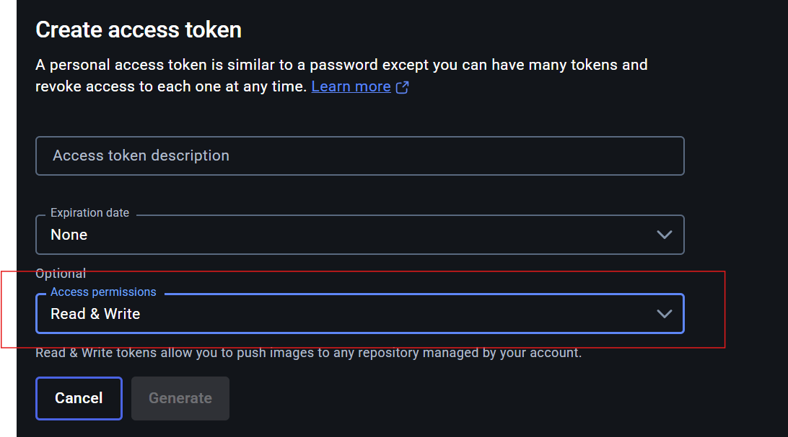
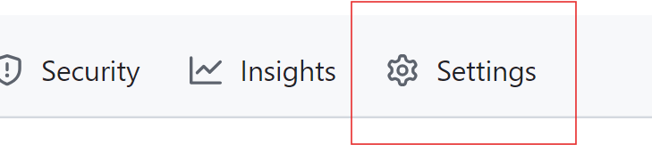
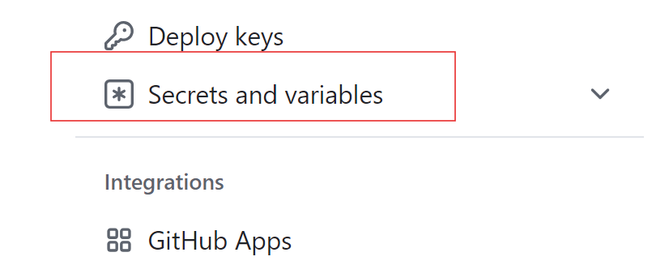
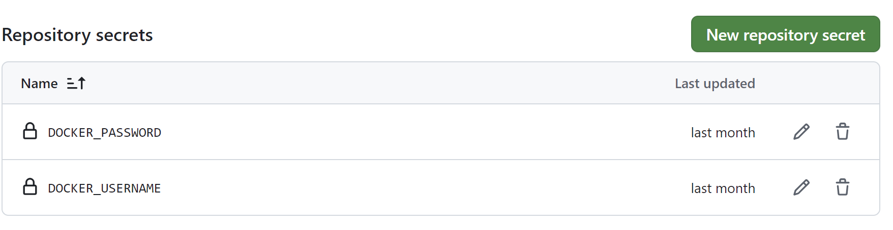

# RF Berlin HPC guide

RF Berlin runs GPU servers for scientific computing that are shared by many researchers. Each researcher works in their **own Docker container**, so nobody can break anyone else's setup, and every environment is documented in a GitHub repository. That makes it easy to share and reproduce, for example for peer review.

> **Fastest way in: the Container Builder** on the internal RF Berlin site (`http://<HPC server>/`; ask your admin for the address).
> Fill in a form and download a ready-made project. Then push it and request your container with one click. The steps below explain the same process in detail.

---

## The servers

| Server | GPUs | CPU | Memory |
|---|---|---|---|
| **RFBerlin-HPC01** | 2x NVIDIA RTX A6000 (48 GB each) | 112 threads | 125 GB |
| **dsserver02** | 1x NVIDIA RTX PRO 6000 Blackwell (96 GB) | 128 threads | 1 TB |

You can't install software on the servers directly. Your container is your own Ubuntu machine: you have `sudo` inside it, you can `pip install` and `apt install`, and you log in with SSH.

## How it works

```
your GitHub repo ──push──▶ GitHub Actions builds the image ──▶ Docker Hub ──▶ your container on the server
 (Dockerfile,                                                                  (updates automatically
  requirements.txt)                                                             ~5 min after each push)
```

1. Your environment (packages, tools, SSH key) is described in a small GitHub repository that you own.
2. Every push to `main` builds a Docker image and publishes it to your Docker Hub account.
3. The server runs a container from that image and picks up new versions automatically.

## What you need

- A **GitHub** account (you will create a private repository).
- A **Docker Hub** account: [sign up for free](https://app.docker.com/signup).
- An **SSH key** (see step 1).

---

## Step 1 – Create an SSH key

You log in to your container with an SSH key; there are no passwords. Open a terminal (Windows: *PowerShell*, macOS/Linux: *Terminal*) and run:

```bash
ssh-keygen -t ed25519 -C "your_email@example.com"
```

Press Enter to accept the defaults. Your **public** key is now in `~/.ssh/id_ed25519.pub`. Only ever share that `.pub` file. The file without `.pub` is your private key and stays on your computer.

```bash
cat ~/.ssh/id_ed25519.pub
```

## Step 2 – Generate your project

Open the **Container Builder** on the internal site and fill in:

- **Container name**, e.g. `jdoe-thesis`, and your **Docker Hub username**.
- **Server**: see the table above.
- **Software**: *Python + CUDA* if you want to use a GPU, otherwise *Python (CPU only)*. Tick **PyTorch** if you need it, and list your Python packages.
- **Resources**: GPU and memory limit.
- **SSH key**: paste the contents of your `.pub` file.

Click **Download project (.zip)** and unzip it. You get:

| File | What it's for |
|---|---|
| `Dockerfile` | The environment. Add system packages here. |
| `requirements.txt` | Python packages, one per line. |
| `authorized_keys` | SSH public keys allowed to log in, one per line. Add a co-author's key to give them access. |
| `start.sh` | Starts the SSH server inside the container. |
| `.github/workflows/docker-publish.yml` | Builds the image and pushes it to Docker Hub on every push. |

<details>
<summary>Prefer to start by hand? Use the DemoProject template instead.</summary>

```bash
git clone https://github.com/RFBerlin/DemoProject.git my-project
cd my-project && rm -rf .git
```

Then replace `id_rsa.pub` with your public key, edit `requirements.txt`, and change the image name `leifhh/demouser` in `.github/workflows/main.yml` to `<your-dockerhub-user>/<image>`.
</details>

## Step 3 – Push it to a private GitHub repository

Create a new **private** repository on GitHub, for example named after your container:



Then, in the unzipped folder:

```bash
git init
git add .
git commit -m "Initial environment"
git branch -M main
git remote add origin https://github.com/USERNAME/REPONAME.git
git push -u origin main
```

## Step 4 – Let GitHub publish to Docker Hub

GitHub needs permission to push images to your Docker Hub account.

**Create a Docker Hub access token.** Log in to Docker Hub, open your profile in the top-right corner and go to **Account settings**:





Go to **Personal access tokens** and click **Generate new token**:



Give it **Read & Write** access and copy the token:



**Add the token to your GitHub repository.** Go to **Settings** → **Secrets and variables** → **Actions**:





Create two **repository secrets**:

| Name | Value |
|---|---|
| `DOCKER_USERNAME` | your Docker Hub username |
| `DOCKER_PASSWORD` | the access token you just created |



## Step 5 – Check the build

Open the **Actions** tab of your repository. The *Build and publish image* run must finish with a green check. If it ran before you added the secrets, open it and click **Re-run jobs**. The first build can take 5–15 minutes, longer with PyTorch.

> Images on a free Docker Hub account are **public**. Never put data, passwords or private keys in the repository. Put them in `/home/ubuntu/work` on the server instead.

## Step 6 – Request your container

Click **Request container** in the Container Builder. It opens a pre-filled [container request](https://github.com/RFBerlin/guide/issues/new?template=container-request.yml) here, so just press **Create**. When the container is running, you'll get your **port number** and the server address in that issue.

## Step 7 – Connect

```bash
ssh -p <port> ubuntu@<server address>
```

You are user `ubuntu` with `sudo` rights. Your Python environment is active automatically, and `nvidia-smi` shows your GPU if you requested one.

**VS Code:** install the *Remote - SSH* extension and add this to `~/.ssh/config`. Then choose *Remote-SSH: Connect to Host…* → `my-container`.

```
Host my-container
    HostName <server address>
    Port <port>
    User ubuntu
```

---

## Working in your container

- **Keep everything in `/home/ubuntu/work`.** It is stored on the server and survives restarts and updates. Everything else is reset when the container is updated.
- **Changing your environment:** edit `requirements.txt` or the `Dockerfile`, commit and push. Your container is updated within about 5 minutes after the build finishes. This restarts the container, so save your work and don't push while long jobs are running.
- **Trying things out:** `pip install` and `sudo apt install` work immediately. Add the packages to your repository afterwards so they survive the next update.
- **PyTorch:** use the *PyTorch* option in the Container Builder. The default `pip install torch` installs a CUDA 13 build that can't use the GPUs on RFBerlin-HPC01.
- **Long jobs:** run them inside `tmux` or `screen`, or with `nohup`, so they keep running when you disconnect.
- **Be fair with GPUs:** they are shared. Free GPU memory when you're done, and say in your request if you need a GPU exclusively.

## Troubleshooting

| Problem | Fix |
|---|---|
| Actions build fails at *docker/login-action* | The `DOCKER_USERNAME` / `DOCKER_PASSWORD` secrets are missing or wrong. |
| `Permission denied (publickey)` | The key in `authorized_keys` doesn't match the key on your computer. Fix it and push. The container updates within ~5 minutes. |
| `torch.cuda.is_available()` is `False` | Use the *Python + CUDA* environment with the *PyTorch* option, and make sure you requested a GPU. |
| My changes didn't arrive | Check that the Actions run is green, then wait ~5 minutes and reconnect. |

Questions: open an [issue](https://github.com/RFBerlin/guide/issues) or contact leh@danofficeit.com.
